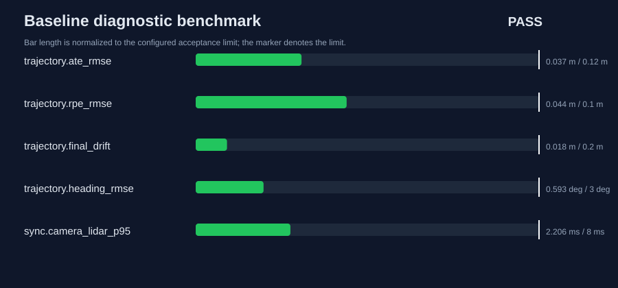
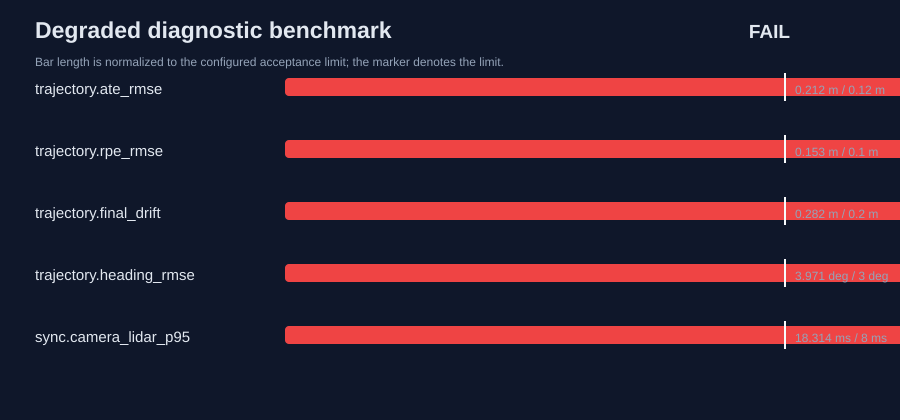

# UAV Multi-Sensor Diagnostics

[](https://github.com/Aleck-Tao/uav-multisensor-diagnostics/actions/workflows/ci.yml)
[](https://www.python.org/)
[](LICENSE)

A reproducible research tool for deciding whether UAV sensor logs and pose estimates are trustworthy enough for downstream perception, mapping, planning, or control experiments.

The tool evaluates three coupled failure surfaces:

- camera, LiDAR, and IMU timestamp jitter, dropped samples, and acquisition-order violations;
- camera-LiDAR nearest-frame synchronization error;
- trajectory quality using aligned ATE, one-second RPE, final drift, heading error, and path-length error.

## Research contribution

The main contribution is an experiment-ingestion quality gate rather than another trajectory plotting script. Every analysis produces a machine-readable verdict, per-metric acceptance decisions, input SHA-256 provenance, a Markdown report, and a dependency-free SVG dashboard. This makes data quality review repeatable before SLAM or perception results are trusted.

## Controlled benchmark

| Scenario | Verdict | ATE RMSE | RPE RMSE (1 s) | Camera-LiDAR sync p95 | LiDAR dropout rate | Failed gates |
|---|:---:|---:|---:|---:|---:|---:|
| Baseline | **PASS** | 0.0370 m | 0.0440 m | 2.206 ms | 0.00% | 0 |
| Degraded | **FAIL** | 0.2119 m | 0.1525 m | 18.314 ms | 2.67% | 11 |

<p>
  
  
</p>

The degraded scenario injects localization drift, a temporary pose disturbance, increased timing jitter, deterministic sample loss, one timestamp-order violation, and a LiDAR clock offset. These are controlled fault-injection results, not claimed as real-flight localization accuracy.

## Reproduce

```bash
python -m pip install -e .
python -m unittest discover -s tests -v
uavdiag benchmark
```

Expected result:

```text
baseline: PASS (0 failed gates)
degraded: FAIL (11 failed gates)
```

The CI workflow reruns the tests and benchmark, then checks that committed data and reports are byte-stable.

## Analyze an experiment log

Prepare a directory containing:

```text
sensor_timestamps.csv
reference_trajectory.csv
estimated_trajectory.csv
```

Run:

```bash
uavdiag analyze path/to/log path/to/report --label flight-07
```

Exit code `0` means every configured gate passed. Exit code `2` means the log requires review.

### Timing schema

```csv
sensor,sequence,timestamp_s
camera,0,0.00000000
camera,1,0.03333333
lidar,0,0.00080000
```

### Trajectory schema

```csv
timestamp_s,x_m,y_m,z_m,yaw_rad
0.000000,0.000000,0.220000,1.450000,0.00000000
```

Reference poses may come from motion capture, RTK/GNSS, a trusted simulator, or another documented reference system. Thresholds in `config/quality_gates.json` are experiment policy, not universal constants.

## Engineering decisions

- Fixed seeds and stable CSV formatting make the benchmark deterministic.
- Sequence gaps measure frame loss independently of timestamp jitter.
- A least-squares rigid XY transform and vertical offset remove arbitrary initial-frame placement without hiding scale error.
- Every report stores hashes for all inputs and the gate configuration.
- NumPy is the only runtime dependency; SVG dashboards require no plotting library.
- The quality decision is fail-closed: one failed metric blocks acceptance.

Detailed metric definitions and assumptions are in [`docs/methodology.md`](docs/methodology.md).

## Repository layout

```text
uavdiag/       importable analysis package and CLI
config/        version-controlled acceptance policy
data/          deterministic baseline and degraded inputs
results/       committed JSON, Markdown, and SVG outputs
tests/         unit and integration tests
docs/          metric and fault-injection methodology
```

## Scope

This repository diagnoses log integrity and trajectory consistency. It is not a SLAM implementation, flight controller, or safety-certified system. Real-flight accuracy claims require calibrated ground truth, documented sensor mounting, synchronized raw logs, and a justified gate configuration.

Related repositories: [research portfolio](https://github.com/Aleck-Tao/computer-vision-autonomous-systems-portfolio), [real flight-video audit](https://github.com/Aleck-Tao/uav-flight-video-quality-audit), and [safety-constrained mission interface](https://github.com/Aleck-Tao/safety-constrained-uav-mission-interface).
